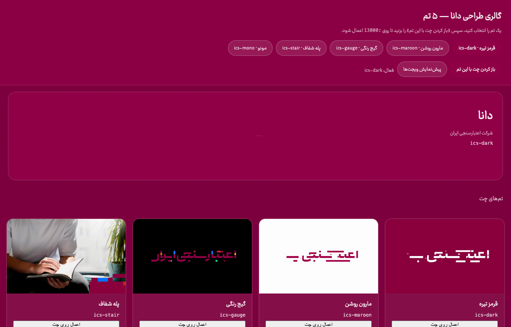
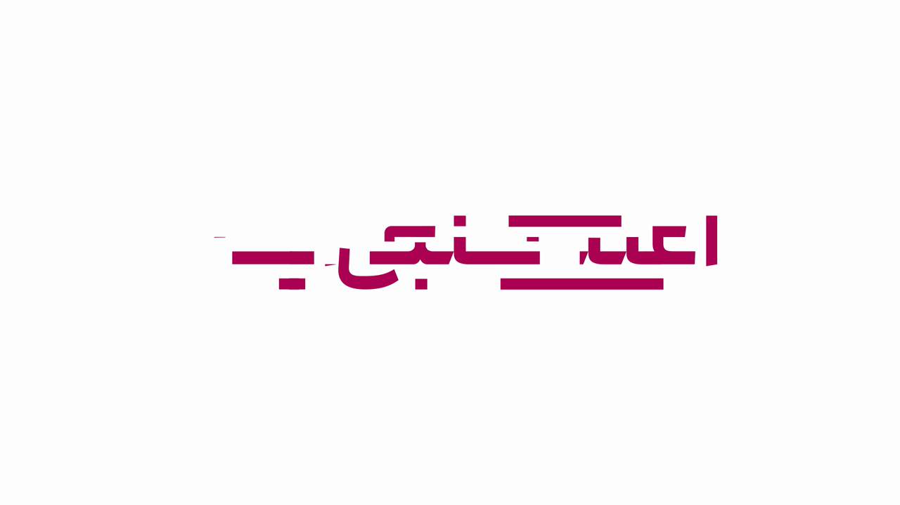
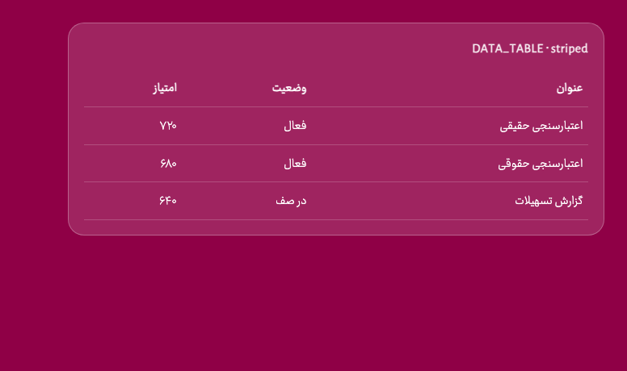
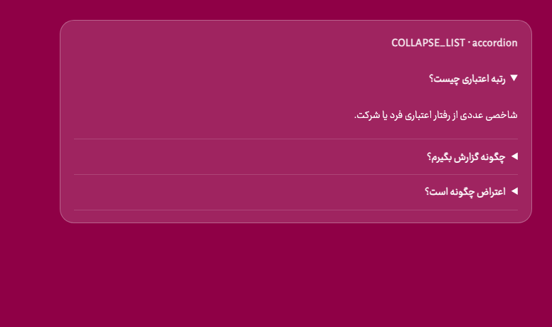
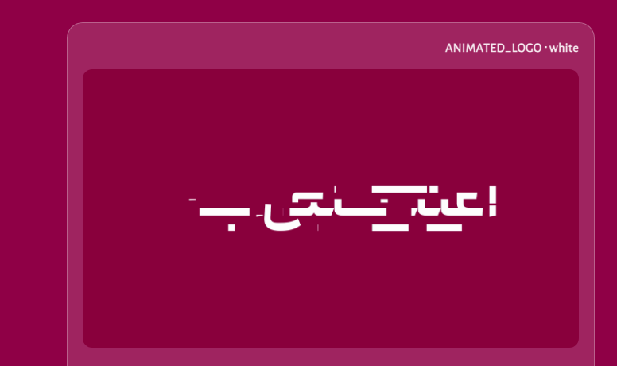
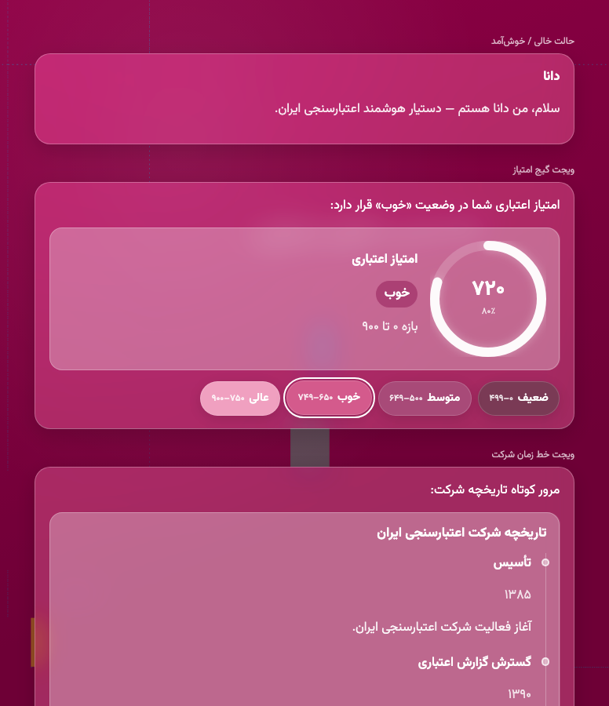

# دانا (Dana) — ICS branded Open WebUI fork

Persian RTL assistant shell for **شرکت اعتبارسنجی ایران (ICS)**. Themes live under `static/dana/themes/`; allowlisted chat widgets under `static/dana/magic-tokens.json`.

Live preview (local):

- Themes gallery: http://127.0.0.1:13000/static/dana/design-gallery.html
- Widgets: http://127.0.0.1:13000/static/dana/ux-preview.html
- Quick switch: http://127.0.0.1:13000/?dana_theme=ics-dark

## Themes

| Id | Role | Preview |
| --- | --- | --- |
| `ics-dark` | Default dark-red brand BG + motion chat background |  |
| `ics-maroon` | Light ICS maroon shell |  |
| `ics-gauge` | Gauge-color motion / accents |  |
| `ics-stair` | Stair transparent motion pack |  |
| `ics-mono` | Mono logo pack |  |
| `vanilla` | Disable Dana brand layer | — |

Admin: Settings → General → دانا / ICS Brand. Env: `DANA_THEME_ID` (see [`docs/dana/env.dana.example`](docs/dana/env.dana.example)).

## Magic tokens

Assistant messages may emit allowlisted tokens. Unknown tokens are ignored (fail closed).

| Token | Renderer | Usage |
| --- | --- | --- |
| `BIRTHDAY` | `BirthdayCake` | `<BIRTHDAY>` |
| `CREDIT_SCORE_BANDS` | `CreditScoreBands` | `<CREDIT_SCORE_BANDS>` or `<<<MAGIC:CREDIT_SCORE_BANDS {…}>>>` |
| `CREDIT_SCORE_GAUGE` | `CreditScoreGauge` | `<<<MAGIC:CREDIT_SCORE_GAUGE {"score":720,"band":"خوب","variant":"ring"}>>>` |
| `COMPANY_TIMELINE` | `CompanyTimeline` | `<<<MAGIC:COMPANY_TIMELINE {"items":[…],"variant":"vertical"}>>>` |
| `INFO_BANNER` | `InfoBanner` | `<<<MAGIC:INFO_BANNER {"title":"اطلاعیه","body":"…"}>>>` |
| `DATA_TABLE` | `DataTable` | `<<<MAGIC:DATA_TABLE {"variant":"striped",…}>>>` |
| `COLLAPSE_LIST` | `CollapseList` | `<<<MAGIC:COLLAPSE_LIST {"variant":"accordion",…}>>>` |
| `ANIMATED_LOGO` | `AnimatedLogo` | `<<<MAGIC:ANIMATED_LOGO {"variant":"white"}>>>` |

Catalog source: [`static/dana/magic-tokens.json`](static/dana/magic-tokens.json) · variants: [`static/dana/magic-variants.json`](static/dana/magic-variants.json)

### CREDIT_SCORE_GAUGE

Variants: `ring` · `arc` · `hero`

### CREDIT_SCORE_BANDS

Colored score-range pills with Persian digits; active band outlined.

### COMPANY_TIMELINE

Variants: `vertical` · `horizontal` · `compact`

### INFO_BANNER

Glass callout banner for ICS notices.

### BIRTHDAY

Animated cake celebration widget.

### DATA_TABLE

Variants: `striped` · `cards` · `dense`

### COLLAPSE_LIST

Variants: `accordion` · `grid` · `chips`

### ANIMATED_LOGO

Variants: `white` · `maroon` · `gauge` (brand motion webm/stills)

### UX montage

