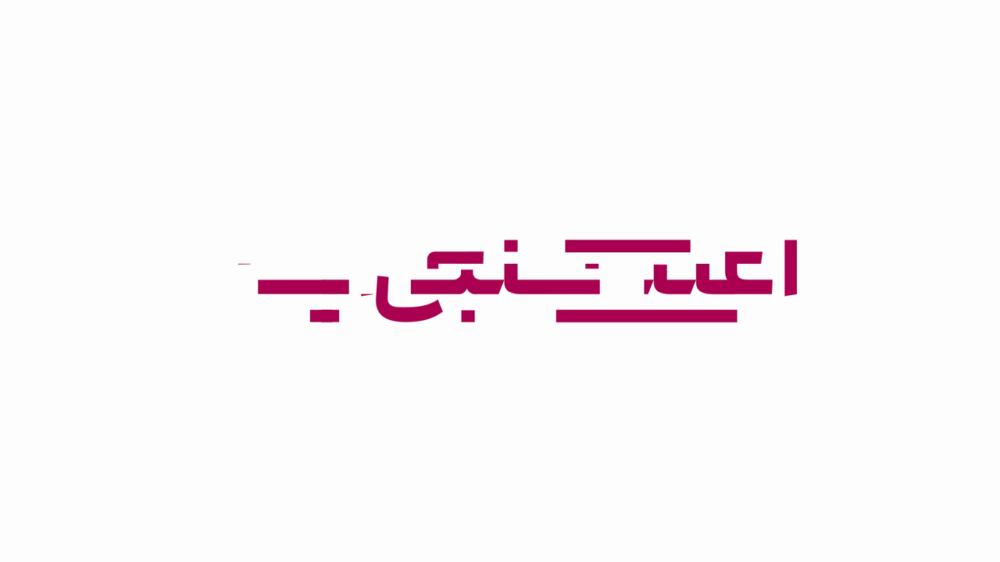
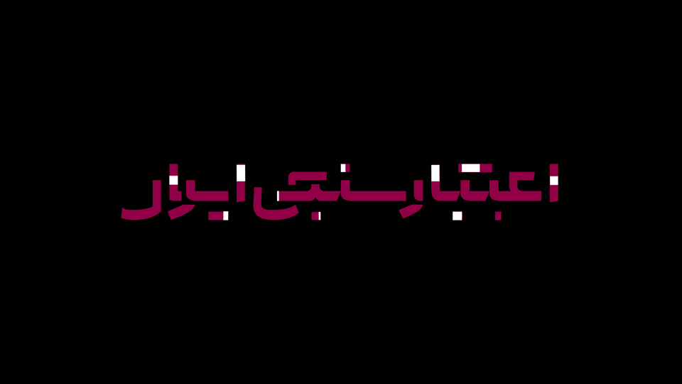
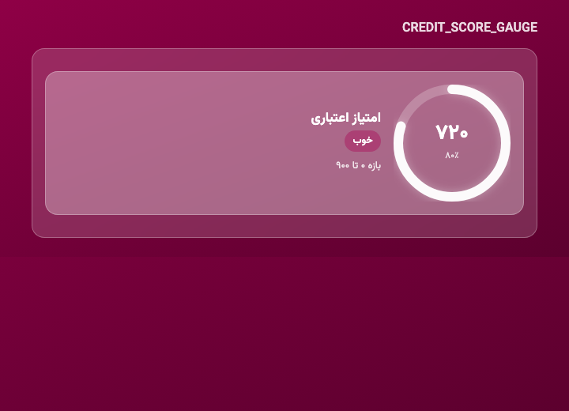
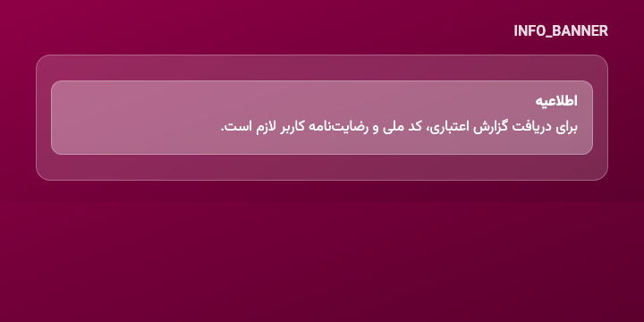

# دانا (Dana) — ICS branded Open WebUI fork

Persian RTL assistant shell for **شرکت اعتبارسنجی ایران (ICS)**. Themes live under `static/dana/themes/`; allowlisted chat widgets under `static/dana/magic-tokens.json`.

Live preview (local):

- Themes gallery: http://127.0.0.1:13000/static/dana/design-gallery.html
- Widgets: http://127.0.0.1:13000/static/dana/ux-preview.html
- **Magic lab (gauges + ICS cards + timeline + shareholders + creditors):** http://127.0.0.1:13000/static/dana/magic-lab.html
- Quick switch: http://127.0.0.1:13000/?dana_theme=ics-maroon

## Themes


| Id | Role | Preview |
| --- | --- | --- |
| `ics-maroon` | **Default** — white / light ICS maroon shell |  |
| `ics-dark` | Dark-red brand BG + motion chat background |  |
| `ics-gauge` | Gauge-color motion / accents |  |
| `ics-stair` | Stair transparent motion pack |  |
| `ics-mono` | Mono logo pack |  |
| `vanilla` | Disable Dana brand layer | — |

Admin: Settings → General → دانا / ICS Brand. Env: `DANA_THEME_ID` (see [`docs/dana/env.dana.example`](docs/dana/env.dana.example)).

## Magic widgets (post-hoc `rag.magic`)

**Production path:** the orchestrator returns widgets on `rag.magic` as
`[{ "name": "TOKEN", "params": {…} }]` **after** the answer is final. Assistant
`content` stays plain Persian — it does **not** contain `<<<MAGIC:…>>>`.

WebUI flow:

1. Final SSE / non-stream chunk includes `rag.magic`
2. Middleware persists `message.magic` and emits `chat:message:magic`
3. `ContentRenderer` / `StructuredOutputRenderer` render via `MagicRenderer`
4. Legacy in-body `<<<MAGIC:…>>>` is still parsed as a fallback for old chats

Unknown token names are ignored (fail closed). Allowlist:
[`static/dana/magic-tokens.json`](static/dana/magic-tokens.json).

| Token | Renderer | Typical `params` |
| --- | --- | --- |
| `CREDIT_SCORE_GAUGE` | `CreditScoreGauge` | `score`, `min`/`max`, `model` (`cheque`\|`person`\|`legal`), `variant` (`ring`\|`horizontal`\|`linear`\|`vertical`\|`arc`\|`hero`), `bands[]` with `color`/`code`/`codes`, `color_mode: "stepped"` |
| `CREDIT_SCORE_BANDS` | `CreditScoreBands` | ladder; `variant` `vertical`\|`horizontal` |
| `CLARIFY_OPTIONS` | `ClarifyOptions` | ICS report cards (حقیقی/حقوقی/چک) → fills composer |
| `COMPANY_TIMELINE` | `CompanyTimeline` | `{ "variant": "vertical" }` |
| `SHAREHOLDERS` | `ShareholdersRing` | ICS company stakeholders only |
| `CREDITORS` | `CreditorsGrid` | ICS data providers only |
| `INFO_BANNER` | `InfoBanner` | `{ title, body }` |
| `DATA_TABLE` | `DataTable` | `{ variant, … }` |
| `COLLAPSE_LIST` | `CollapseList` | `{ variant, … }` |
| `ANIMATED_LOGO` | `AnimatedLogo` | `{ variant }` |
| `BIRTHDAY` | `BirthdayCake` | (simple / legacy) |

Catalog: [`static/dana/magic-tokens.json`](static/dana/magic-tokens.json) · variants: [`static/dana/magic-variants.json`](static/dana/magic-variants.json)

> Lab / docs may still show `<<<MAGIC:…>>>` strings for manual preview in
> `magic-lab.html`. Chat completions from the orchestrator use `rag.magic` only.

### CREDIT_SCORE_GAUGE (B — ring)

Solid white card (no glass). Semicircle red→green gradient, animated fill + count-up, tip dot.
Variants: `ring` (default) · `arc` · `hero`



### CREDIT_SCORE_BANDS (A — ladder)

Solid vertical color ladder with sliding black needle (+ optional `horizontal` pills).
Variants: `vertical` (default) · `horizontal`


### CLARIFY_OPTIONS

ICS24 white report cards (حقیقی / حقوقی / چک) with title, subtitle, and «توضیحات بیشتر». Companion token — can appear alongside one visual gauge.
Assets: `static/dana/brand/icons/magic/ics24/clarify/{person,legal,cheque}.png`

```json
{ "name": "CLARIFY_OPTIONS", "params": { "title": "لطفاً نوع گزارش را انتخاب کنید", "items": [] } }
```

### COMPANY_TIMELINE

Animated zigzag history (۱۳۸۵→۱۴۰۳). Variants: `vertical` · `horizontal` · `compact`. Default items match ics24.ir about/history.

```json
{ "name": "COMPANY_TIMELINE", "params": { "variant": "vertical" } }
```


### SHAREHOLDERS

Animated donut + percent card (autoplay). Catalog: `static/dana/magic-data/shareholders.json` (logos under `brand/icons/magic/ics24/shareholders/`).

```json
{ "name": "SHAREHOLDERS", "params": { "title": "سهامداران شرکت اعتبارسنجی ایران" } }
```

### CREDITORS

Multi-tab grid (بانک ها / سازمان ها / بیمه ها / لیزینگ ها / لندتک ها). Catalog: `static/dana/magic-data/creditors.json`.

```json
{ "name": "CREDITORS", "params": { "title": "تأمین‌کنندگان داده‌های شرکت اعتبارسنجی ایران" } }
```

### INFO_BANNER

Glass callout banner for ICS notices.



### BIRTHDAY

Animated cake celebration widget.


### DATA_TABLE

Variants: `striped` · `cards` · `dense`


### COLLAPSE_LIST

Variants: `accordion` · `grid` · `chips`


### ANIMATED_LOGO

Variants: `white` · `maroon` · `gauge` (brand motion webm/stills)


### UX montage


