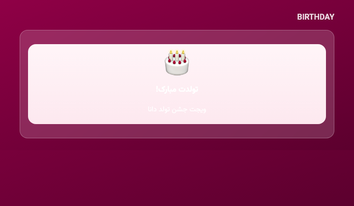
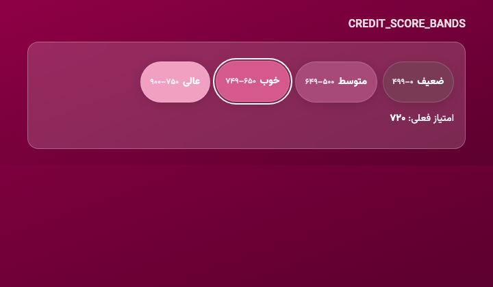
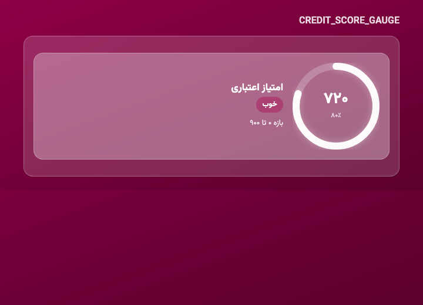
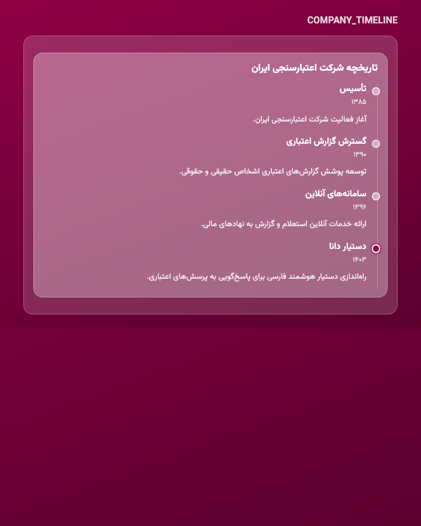
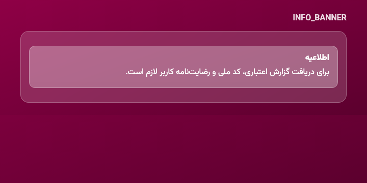

# دانا (Dana) — ICS branded Open WebUI fork

Persian RTL assistant shell for **شرکت اعتبارسنجی ایران (ICS)**. Themes live under `static/dana/themes/`; allowlisted chat widgets under `static/dana/magic-tokens.json`.

Live preview (local): http://127.0.0.1:13000/static/dana/ux-preview.html

## Magic tokens

Assistant messages may emit allowlisted tokens. Unknown tokens are ignored (fail closed).

| Token | Renderer | Usage |
| --- | --- | --- |
| `BIRTHDAY` | `BirthdayCake` | `<BIRTHDAY>` |
| `CREDIT_SCORE_BANDS` | `CreditScoreBands` | `<CREDIT_SCORE_BANDS>` or `<<<MAGIC:CREDIT_SCORE_BANDS {…}>>>` |
| `CREDIT_SCORE_GAUGE` | `CreditScoreGauge` | `<<<MAGIC:CREDIT_SCORE_GAUGE {"score":720,"band":"خوب"}>>>` |
| `COMPANY_TIMELINE` | `CompanyTimeline` | `<<<MAGIC:COMPANY_TIMELINE {"items":[…]}>>>` |
| `INFO_BANNER` | `InfoBanner` | `<<<MAGIC:INFO_BANNER {"title":"اطلاعیه","body":"…"}>>>` |

Catalog source: [`static/dana/magic-tokens.json`](static/dana/magic-tokens.json)

### BIRTHDAY

Animated cake celebration widget.

### CREDIT_SCORE_BANDS

Colored score-range pills with Persian digits; active band outlined.

### CREDIT_SCORE_GAUGE

Animated ring gauge (VibeFarsi progress-ring pattern) with Persian score.

### COMPANY_TIMELINE

RTL company-history timeline (VibeFarsi timeline rail at inline-start).

### INFO_BANNER

Glass callout banner for ICS notices.

## Themes

| Id | Role |
| --- | --- |
| `ics-maroon` | Light ICS maroon shell |
| `ics-dark` | Default dark-red brand BG + motion chat background |
| `vanilla` | Disable Dana brand layer |

Admin: Settings → General → دانا / ICS Brand.
